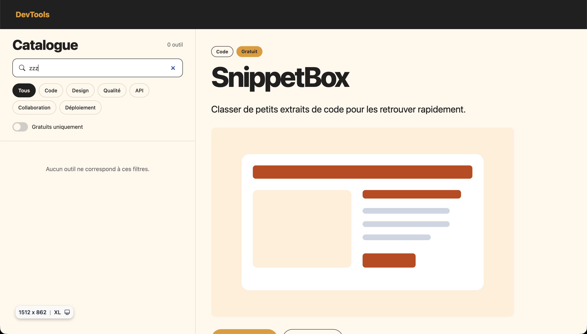

on veut faire ca . 
#21201E - dark
#FFF8ED - clair
#E69925 - orange

## Besoin, public et démarche

La page DevTool s'adresse à des développeurs de tous niveaux qui recherchent des outils de dev pratique. DevTool répond à cette demande en proposant une liste de 24 outils.
Pour facilité la recherche de l'utilisateur, la page se sépare en deux sections disctinctes :
- Une section "Recherche", avec la liste des outils, mais egalement les fonctionnalitées de recherche comme la searchbar ou les filtres par catégorie.
- Une section "Détails", qui une fois un outil selectionné, va afficher dynamiquement des informations supplémentaires comme une description, les autres outils de la même catégorie ou un bouton vers le lien si il est disponible.

Nous avons organisé notre travail en différentes étapes :
1. Selection de la palette de couleur
2. Réalisation d'un wireframe sur excalidraw
3. Création du projet sur git et les fichiers de base
4. Création de l'architecture HTML
5. Répartition des tâches pour la réalisation du script JS et du style des sections de la page

Blocage : Organisation à deux sur un seul fichier, il a fallut clairement séparer le travail afin de ne pas toucher au même morceau de code pour essayer d'éviter les conflit.

## Architecture et circulation des données

Fichiers et rôle
- `index.html` : structure de la page (section Recherche + section Détails). Charge `dist/output.css`, `dist/badge.css` et `src/main.js`.
- `src/main.js` : charge les données, gère les filtres, affiche la liste, le compteur, l'état vide et le détail.
- `src/datas/outils.json` : **source de données retenue**, les 24 outils (id, nom, description, categorie, gratuit, lien).
- `src/input.css` : point d'entrée Tailwind, compilé dans `dist/output.css`.
- `src/scss/badge.scss` : styles du badge prix, compilé dans `dist/badge.css`.

Chaque outil a un champ gratuit (`true` ou `false`). Il sert pour :
- le filtre « gratuits uniquement »
- le badge de prix du détail : texte « Gratuit » ou « Payant »

Le tableau `outils` n'est jamais modifié après le chargement. Chaque filtrage crée un nouveau tableau à partir de lui. Quand on vide la recherche et qu'on remet le filtre sur `Tous`, les 24 outils réapparaissent.

## Trois extraits de votre code expliqués

**1) Boucle et condition du badge** : `src/main.js`, fonction `afficherListe()`
```js
for (let i = 0; i < outilsFiltres.length; i++) {
    const outil = outilsFiltres[i];

    let badge = '<span class="badge badge--price is-paid px-2 py-0.5">Payant</span>';
    if (outil.gratuit) {
        badge = '<span class="badge badge--price is-free px-2 py-0.5">Gratuit</span>';
    }
    // ... ${badge} est ensuite inséré dans la carte de l'outil
}
```
- Traitement : la boucle passe sur chaque outil. Si `outil.gratuit` vaut `true`, le badge prend la classe `is-free` et le texte « Gratuit », sinon la classe `is-paid` et le texte « Payant ».
- Résultat visible : chaque carte de la liste affiche un badge orange « Gratuit » ou un badge foncé « Payant ».

**2) Recherche et gestion des états** : `src/main.js`, fonctions `filtrerOutils()` et `afficherListe()`
```js
champRecherche.addEventListener('input', function () {
    recherche = champRecherche.value;
    afficherListe();
});

// dans filtrerOutils()
const texte = recherche.toLowerCase();
if (
    (outil.nom.toLowerCase().includes(texte) || outil.description.toLowerCase().includes(texte)) &&
    (categorieActive === 'Tous' || outil.categorie === categorieActive) &&
    (!gratuitsUniquement || outil.gratuit)
) { resultat.push(outil); }

// dans afficherListe()
messageVide.hidden = outilsFiltres.length > 0;
```
- **Entrée** : le texte tapé, plus deux états gardés dans des variables : `categorieActive` (bouton de catégorie cliqué) et `gratuitsUniquement` (interrupteur).
- **Traitement** : à chaque frappe, le texte est stocké dans `recherche` et la liste est recalculée. Tout est passé en minuscules, puis on garde les outils qui respectent les trois conditions en même temps : texte trouvé dans le nom ou la description, bonne catégorie, et gratuit si le filtre est activé. Le tableau `outils` d'origine n'est jamais modifié.
- **Résultat visible** : la liste et le compteur se mettent à jour en direct. S'il n'y a aucun résultat, le message « Aucun outil ne correspond à ces filtres. » apparaît.

**3) Variable et mixin Sass** : `src/scss/badge.scss`, sélecteur `.badge--price`
```scss
$accent: #E69925;
$fonce: #21201E;
$clair: #FFF8ED;

@mixin badge-variant($fond, $texte) {
    background-color: $fond;
    color: $texte;
    border: 1px solid $fond;
}

.badge--price {
    &.is-free { @include badge-variant($accent, $fonce); }
    &.is-paid { @include badge-variant($fonce, $clair); }
}
```
- **Entrée** : les variables de couleur (`$accent`, `$fonce`, `$clair`) et les classes `is-free` / `is-paid` ajoutées par le JS.
- **Traitement** : le mixin `badge-variant` reçoit une couleur de fond et une couleur de texte, et génère les 3 propriétés CSS. On l'appelle deux fois avec des couleurs inversées, au lieu d'écrire deux fois le même bloc. Sass compile le tout en CSS classique dans `dist/badge.css`.
- **Résultat visible** : le badge « Gratuit » est orange avec un texte foncé, le badge « Payant » est foncé avec un texte clair, dans la liste comme dans le détail.


## Styles et build reproductible

Commandes
```bash
npm install
npm run dev
npm run dev:sass
npm run build
npm run build:sass
```

Entrées et sorties
| Outil | Entrée | Sortie |
|---|---|---|
| Tailwind | `src/input.css` | `dist/output.css` |
| Sass | `src/scss/badge.scss` | `dist/badge.css` |

Les deux compilations sont indépendantes. On lance Tailwind puis Sass, dans n'importe quel ordre. Ce qui compte, c'est l'ordre de chargement dans `index.html` : `output.css` est chargé en premier, puis `badge.css`. Les styles des badges passent donc après Tailwind et peuvent le surcharger.
Le dossier `dist/` est dans `.gitignore`. Il faut donc lancer les builds après un clone.

Tailwind scanne automatiquement les fichiers du projet, il lit `src/main.js` et génère les classes écrites dans les gabarits HTML du JS.

Flexbox ou Grid
- **Flexbox** pour ce qui s'aligne sur un seul axe : la page (barre latérale + détail côte à côte), la liste des outils en colonne, les filtres qui passent à la lign, les boutons.
- **Grid** pour les blocs en colonnes égales : les 3 infos du détail et les outils similaires.

En plus des breakpoints de Tailwind, nous avons créé un breakpoint perso dans `src/input.css` :
```css
--breakpoint-desktop: 800px;
```

| Élément | À 390 px | À 1280 px |
|---|---|---|
| Disposition (`.layout`, `.sidebar`) | Une seule colonne : le catalogue prend toute la largeur (`w-full`) | Deux colonnes : catalogue à gauche (`desktop:w-1/3`), détail à droite (`desktop:w-2/3`) |
| Défilement (`body`) | Toute la page défile (`min-h-screen`) | La page fait la hauteur de l'écran (`desktop:h-screen`) et chaque colonne défile séparément (`desktop:overflow-y-auto`) |
| Détail (`.detail`) | Caché par défaut, s'ouvre en **modal** plein écran au clic sur un outil (`max-desktop:hidden`, `max-desktop:fixed`) | Toujours visible dans la colonne de droite |
| Outils similaires | 1 colonne | 3 colonnes |

Sur mobile, il n'y a pas la place pour mettre la liste et le détail côte à côte. C'est pour ça qu'on a choisi cette solution avec l'affichage des détails sous forme de modal.

## Tests avec résultats observés

| # | Action | Résultat attendu | Résultat observé | Correction / nouveau test |
|---|---|---|---|---|
| 1 | Ouvrir la page | 24 outils, compteur « 24 outils », détail de SnippetBox | Conforme : les 24 outils s'affichent dans la liste, avec le détail de SnippetBox | Aucune |
| 2 | Taper `json` | 1 outil (JSONView), compteur « 1 outil » | Conforme : seul JSONView s'affiche, compteur « 1 outil » | Aucune |
| 3 | Taper `JSON` (majuscules) | Même résultat que `json` : la recherche ignore la casse | Conforme : JSONView s'affiche | Aucune |
| 4 | Taper `zzz` | 0 outil, message « Aucun outil ne correspond à ces filtres. » | Conforme : le message s'affiche, compteur « 0 outil » | Aucune |
| 5 | Vider le champ | Retour aux 24 outils | Conforme : les 24 outils s'affichent à nouveau | Aucune |
| 6 | Saisir uniquement des espaces `   ` | Les 24 outils | État vide (0 outil) | Ajout de `.trim()` dans `filtrerOutils()` → nouveau test : 24 outils |
| 7 | Cliquer sur la catégorie « Design » | 4 outils | Conforme : 4 outils Design, le bouton « Design » est actif | Aucune |
| 8 | Activer « Gratuits uniquement » | 16 outils | Conforme : 16 outils, l'interrupteur passe en orange | Aucune |
| 9 | « Design » + « Gratuits uniquement » | 2 outils | Conforme : 2 outils, les deux filtres se cumulent | Aucune |
| 10 | Revenir sur « Tous », désactiver le filtre, vider le champ | Les 24 outils | Conforme : les 24 outils reviennent | Aucune |
| 11 | Cliquer sur un outil | Le détail se met à jour (titre, badges, similaires) | Conforme : titre, badges, infos et outils similaires changent | Aucune |
| 12 | À 390 px, cliquer sur un outil puis Échap | Le modal s'ouvre puis se ferme | Conforme : le modal s'ouvre en plein écran et se ferme avec Échap | Aucune |

**Preuves**

Recherche "zzz" : état vide et compteur à 0


Recherche "ENV"


## Contributions, limites et aides

Membres : Carlos Guillermo et Elio Dikoume

**Carlos**
- Contribution : réalisation du script
- Décision : manière d'afficher en mobile
- Vérification : affichage du mobile

**Elio**
- Contribution : mise en place d'une première version du style
- Décision : charte graphique
- Vérification : la responsivité du design

**Limites connues**
- Bouton "Enregistrer" reinitialisé au rechargement de la page.
- 14 outils sur 24 n'ont pas de lien.

**Amélioration prioritaire** : sauvegarder les outils enregistrés dans le `localStorage`. Aujourd'hui, la fonctionnalité existe mais elle ne survit pas à un rechargement, donc elle est peu utile.

**Ressources et aides** : documentation Tailwind CSS v4 et Sass, MDN (`fetch`, `addEventListener`). Claude (IA) a été utilisé pour les conflit git, quelques ajustement d'architecture html (notement la modale), mise en page de certaine partie du readme.
